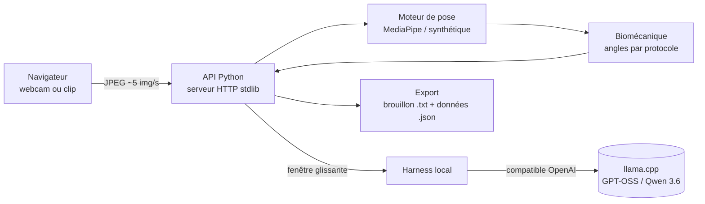

# Kiné Motion — analyse de pose

**Analyse d'angles articulaires par webcam, entièrement sur votre machine.** L'estimation de pose en temps réel (MediaPipe) mesure sept mouvements de kinésithérapie en 2D, et un LLM local optionnel (GPT-OSS / Qwen 3.6) commente la qualité du suivi — sans cloud, sans vidéo écrite sur disque.

[](https://github.com/Matt95354855/kine-motion-pose-analysis/actions/workflows/tests.yml)     

[English](README.md) · [Français](README.fr.md)

## Points forts

- **7 mouvements guidés** — flexion du coude, du genou, de la hanche, élévation latérale de l'épaule, inclinaison du tronc et du cou, rotation guidée du cou — chacun avec sa vue caméra, ses repères et sa définition d'angle.
- **Mesures honnêtes** : les pertes de suivi sont datées et jamais interpolées ; un watchdog de 3 secondes interrompt définitivement une capture sans nouvelles images ; un défaut de suivi n'est jamais présenté comme un geste incorrect.
- **Confidentialité dès la conception** : la vidéo reste en mémoire, le LLM voit une fenêtre glissante plafonnée à 5 s / 25 observations / 2 JPEG, et la preuve de séance est effacée après 15 minutes.
- **LLM local borné** : un seul slot d'inférence, budgets de 10 s en direct / 30 s pour la note, codes factuels vérifiés contre la mesure — le modèle n'écrit jamais de texte libre dans le compte rendu.
- **307 tests automatisés** (215 Python + 92 JavaScript) en CI Linux et Windows ; dépendances de pose verrouillées par hash et poids vérifiés par SHA-256.

## Architecture



Le poste webcam et la machine GPU peuvent être deux ordinateurs reliés par un tunnel SSH chiffré ; l'API et le LLM restent sur la boucle locale de la machine GPU.

## Démarrage rapide

```bash
git clone https://github.com/Matt95354855/kine-motion-pose-analysis.git
cd kine-motion-pose-analysis
python -m scripts.start_local --demo      # puis ouvrir http://127.0.0.1:8765
```

Le mode démo ne demande que Python 3.11. La pose réelle, l'installation sur deux machines et l'assistant LLM sont décrits dans le [guide détaillé](docs/GUIDE.fr.md).

## Structure du dépôt

```text
apps/web/          interface monopage : boucle de capture, personnage guide, surimpression
services/api/      API HTTP, état de séance, intégrité de capture, gestion de l'inférence, provenance
packages/pose/     moteurs de pose MediaPipe et synthétique, traitement JPEG
packages/biomechanics/  protocoles de mouvement et géométrie des angles
packages/harness/  client LLM local, fenêtre glissante, outils, note finale
scripts/           lanceur, diagnostic d'installation, benchmark de pose, client tunnel
tests/             suites de tests Python et JavaScript
docs/              exigences, registre des risques, matrice d'acceptation, avancements
```

## Périmètre et limites

Prototype de recherche, **pas un dispositif médical** : les projections 2D ne sont pas des mesures cliniques validées, et il n'y a ni diagnostic ni programme thérapeutique automatique. La précision angulaire face à des références annotées n'est pas encore qualifiée. Voir [destination du logiciel](docs/intended-use.md), [registre des risques](docs/risk-register.md) et [travail restant](docs/remaining-work.md).

## Documentation

[Guide détaillé](docs/GUIDE.fr.md) · [Protocoles de mouvement](docs/movement-protocols.md) · [Deux machines](docs/two-machine-setup.md) · [Harness en direct](docs/live-harness.md) · [Matrice d'acceptation](docs/acceptance-matrix.md)

## Licence

MIT — voir [LICENSE](LICENSE).
