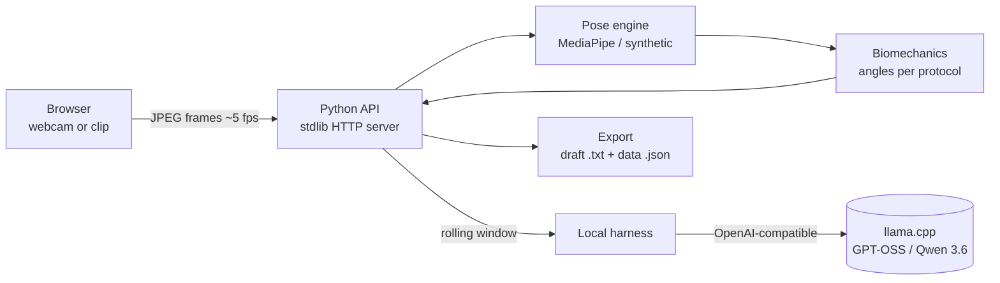

# Kiné Motion — pose analysis

**Webcam-based joint-angle analysis that runs entirely on your own machine.** Real-time pose estimation (MediaPipe) measures seven physiotherapy movements in 2D, and an optional local LLM (GPT-OSS / Qwen 3.6) comments on tracking quality — no cloud, no video written to disk.

[](https://github.com/Matt95354855/kine-motion-pose-analysis/actions/workflows/tests.yml)     

[English](README.md) · [Français](README.fr.md)

## Highlights

- **7 guided movements** — elbow, knee, hip flexion, shoulder abduction, trunk and neck side-bending, guided neck rotation — each with its own camera view, landmarks and angle definition.
- **Honest measurements**: tracking losses are timestamped and never interpolated; a 3-second watchdog permanently aborts a capture when frames stop arriving; a tracking defect is never reported as an incorrect movement.
- **Privacy by design**: video stays in memory, the LLM sees a rolling window capped at 5 s / 25 observations / 2 JPEGs, and the session evidence is erased after 15 minutes.
- **Bounded local LLM**: one inference slot, 10 s live / 30 s report budgets, structured fact codes checked against the measurement — the model never writes free text into the final report.
- **307 automated tests** (215 Python + 92 JavaScript) on Linux and Windows CI; pinned, hash-locked pose dependencies and SHA-256-verified model weights.

## Architecture



The webcam machine and the GPU machine can be two computers joined by an encrypted SSH tunnel; the API and LLM stay on the GPU host's loopback.

## Quick start

```bash
git clone https://github.com/Matt95354855/kine-motion-pose-analysis.git
cd kine-motion-pose-analysis
python -m scripts.start_local --demo      # then open http://127.0.0.1:8765
```

Demo mode needs only Python 3.11. Real pose estimation, the two-machine setup and the LLM assistant are covered in the [detailed guide](docs/GUIDE.fr.md).

## Repository structure

```text
apps/web/          single-page UI: capture loop, guide character, live overlay
services/api/      HTTP API, session state, capture integrity, inference gate, provenance
packages/pose/     MediaPipe and synthetic pose engines, JPEG handling
packages/biomechanics/  movement protocols and angle geometry
packages/harness/  local LLM client, rolling window, tool calls, final report
scripts/           launcher, install check, pose benchmark, tunnel client
tests/             Python and JavaScript test suites
docs/              requirements, risk register, acceptance matrix, progress reports
```

## Scope and limitations

Research prototype, **not a medical device**: 2D projections are not validated clinical measurements, and there is no diagnosis or automatic treatment plan. Angular accuracy against annotated references has not been qualified yet. See [intended use](docs/intended-use.md), [risk register](docs/risk-register.md) and [remaining work](docs/remaining-work.md).

## Documentation

[Detailed guide (FR)](docs/GUIDE.fr.md) · [Movement protocols](docs/movement-protocols.md) · [Two-machine setup](docs/two-machine-setup.md) · [Live harness](docs/live-harness.md) · [Acceptance matrix](docs/acceptance-matrix.md)

## License

MIT — see [LICENSE](LICENSE).
